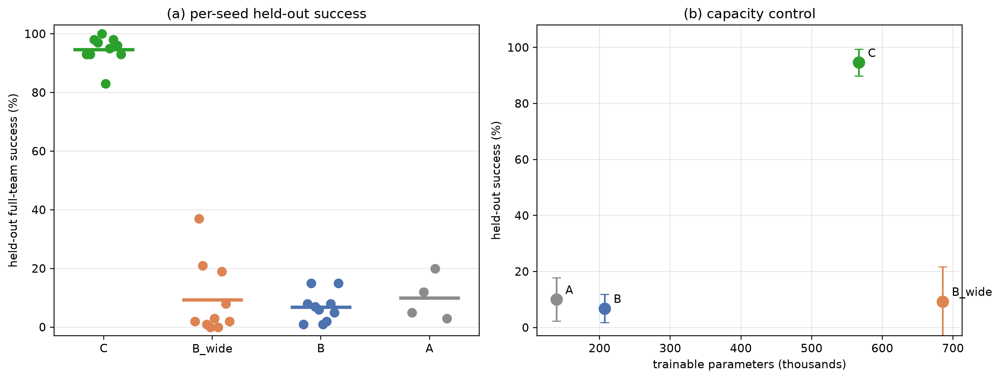
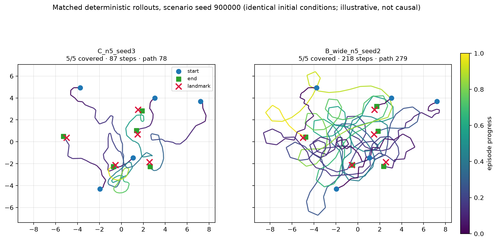

# Multi-Agent Reinforcement Learning for Multi-Robot Landmark Coverage

[](LICENSE)
[](https://doi.org/10.3390/ai7100411)
[](https://doi.org/10.3390/robotics15070119)
[](https://doi.org/10.18196/jrc.v6i6.28387)

Research code for **cooperative landmark coverage by teams of differential-drive
robots** trained with multi-agent reinforcement learning. Every robot runs the
same shared policy in a CUDA-accelerated [PettingZoo](https://pettingzoo.farama.org/)
`ParallelEnv` with continuous 2D dynamics. A Hungarian assignment between robots
and landmarks shapes the reward. Episodes succeed only when **every** robot has
reached a landmark.

The repository accompanies three peer-reviewed articles:

| Paper | What it contributes | Main code |
|---|---|---|
| **AI 2026** — *Masked Entity-Attention MAPPO* | Controlled multi-seed study: structuring the scene as masked entity tokens makes MAPPO training reliable | `rl/mappo.py`, `models/graph_nets.py`, `custom_envs/diff_driven/graph_coverage_env.py` |
| **Robotics 2026** — *Decentralized Shared Actor–Critic* | Shared actor–critic for collision-aware coverage by teams of 4–6 robots | `rl/maddpg.py`, `run/train_done*.py` |
| **JRC 2026** — *Adaptive Replay Strategies* | Tagged replay buffer and offline replay augmentation for stable off-policy training | `tagged_replay_buffer.py`, `run/train_done350*.py` |

> **Please cite.** Use of this code requires citing the relevant publications
> (see [Citation](#citation) and [`LICENSE`](LICENSE)).

<p align="center">
  
</p>
<p align="center"><em>AI 2026: held-out full-team success of ten independently
trained policies per configuration. Masked entity attention (C) reaches
94.6 ± 4.7%. The ordinary and widened fixed-index MLPs (B, B_wide) reach
6.8 ± 5.1% and 9.3 ± 12.4%.</em></p>

<p align="center">
  
</p>
<p align="center"><em>Matched rollouts from the same initial scene: the
entity-attention policy (left) and the wide fixed-index MLP (right).</em></p>

<p align="center">
  
  
</p>
<p align="center"><em>Robotics / JRC 2026: learned trajectories of a six-robot
team among obstacles (left) and training convergence for n = 4, 5, 6 (right).</em></p>

---

## Contents

- [Installation](#installation)
- [Repository layout](#repository-layout)
- [Quick start](#quick-start)
- [Reproducing the papers](#reproducing-the-papers)
- [Citation](#citation)
- [License](#license)

## Installation

You need Python 3.10–3.12 and an NVIDIA GPU. The environment and the learners
run on CUDA by default.

```bash
git clone https://github.com/qyzyrqanov/dif_driven_maddpg.git
cd dif_driven_maddpg
python -m venv .venv
source .venv/bin/activate            # Windows: .venv\Scripts\activate
# install PyTorch for your CUDA version first: https://pytorch.org/get-started/locally/
pip install -r requirements.txt
```

`requirements.txt` lists the direct dependencies. `requirements-linux.txt` pins
the exact environment (Python 3.12, PyTorch 2.13 + CUDA 13) used for the
AI 2026 experiments.

## Repository layout

| Path | Contents |
|---|---|
| `custom_envs/diff_driven/gym_env/centered_paralelenv/env.py` | Differential-drive PettingZoo environments with the 9-component reward (Robotics / JRC) |
| `custom_envs/diff_driven/graph_coverage_env.py` | Entity-structured coverage environment with the redesigned reward (AI) |
| `rl/maddpg.py` | `MADDPGBase` and the shared actor–critic MADDPG / IDDPG variants |
| `rl/mappo.py` | MAPPO with flat (MLP) and entity-structured (attention / Deep Sets) networks |
| `rl/convergence.py` | Success-rate-plateau stopping rule shared by all learners |
| `models/` | Actors and critics: `SimpleActor`, `SharedCritic`, `MultiheadCritic`, MAPPO MLPs, entity encoders |
| `baselines/` | Off-policy MADDPG / IDDPG controls written from scratch (AI) |
| `tagged_replay_buffer.py`, `replay_buffer.py` | Replay buffers; the tagged buffer reserves capacity for goal-reaching transitions |
| `config.py` | Global defaults and device selection |
| `run/` | Training and evaluation entry points (`*.py`) and launchers (`*.sh`, `*.ps1`) |
| `tools/` | Aggregation, figure and notebook generators, diagnostics |
| `res/` | Analysis notebooks |
| `docs/` | [Configuration and paths](docs/CONFIGURATION.md), README figures |

## Quick start

Put the repository root on `PYTHONPATH`, since all imports are absolute. Training scripts
write checkpoints, logs and plots into `--out_dir`. The older `run/train_done*.py`
scripts write into the current working directory instead.

```bash
source .venv/bin/activate
export PYTHONPATH=$(pwd)

# Masked entity-attention MAPPO (configuration C of the AI paper), 5 robots
python run/train_seeded.py --algorithm mappo --n 5 --mode full --seed 1 \
    --v_ang_max pi2 --reward new --obs graph --no_step_csv \
    --convergence --conv_max_hours 3 --conv_max_episodes 5000 \
    --out_dir runs/C_n5_seed1

# Held-out evaluation on the common 100-scenario bank
python run/eval_frozen.py runs/C_n5_seed1 --episodes 100 --seed0 900000 \
    --out runs/heldout_eval.csv
```

Restarting a run with the same output directory resumes from its last
checkpoint. All storage locations can be overridden with environment variables;
see [`docs/CONFIGURATION.md`](docs/CONFIGURATION.md).

## Reproducing the papers

### AI 2026 — Masked entity-attention MAPPO

Every configuration uses the same trainer, `run/train_seeded.py --algorithm mappo`,
with five robots and convergence-based stopping. Configurations differ only in
their flags:

| ID | Configuration | Flags |
|---|---|---|
| **C** | Masked entity-attention actor–critic (proposed) | `--reward new --obs graph` |
| B | Fixed-index MLP | `--reward new --obs flat` |
| B_wide | Wider fixed-index MLP (1.21× C's parameters) | `--reward new --obs flat --mlp_hidden 512` |
| D | Masked Deep Sets | `--reward new --obs graph --entity_encoder deepsets` |
| E | Attention without the completed-entity mask | `--reward new --obs graph --no_entity_mask` |
| A | Legacy 9-component reward (context only) | `--reward legacy --no_done_as_obstacles` |

| Experiment | Launcher | Evaluator |
|---|---|---|
| Principal comparison, seeds 1–5 | `run/run_ppo_study.sh` | `run/eval_frozen.py` → `tools/aggregate_heldout.py` |
| Principal comparison, seeds 6–10 | `run/run_r2_3_additional_seeds.sh` | `run/run_r2_3_heldout_eval.sh` |
| Component controls D, E | `run/run_ablation_stream.sh` | `run/run_ablation_eval_after_training.sh` |
| Learning-rate sensitivity (3 × 3, 45 policies) | `run/run_r2_2_lr_sensitivity.sh` | `run/eval_frozen.py` |
| Zero-shot team size and workspace scale | — | `run/run_r2_5_cardinality_density.sh` (`run/eval_zeroshot.py`) |
| Distribution shift (landmarks, sensing, actuation) | — | `run/run_r2_4_shift.sh` (`run/eval_shift.py`) |
| Collision-projection audit | — | `run/run_collision_audit.sh` (`run/eval_collision_audit.py`) |
| Off-policy MADDPG / IDDPG controls | `run/train_offpolicy_baseline.py` | `run/eval_offpolicy_baselines.py` |

The launchers record the exact compute caps for each batch of runs. Every run
also writes its full configuration to `meta.json`. Figures are produced by
`tools/create_*_figure.py`, `tools/matched_trajectories.py` and
`res/ppo_study_results.ipynb` (generated by `tools/create_ppo_study_notebook.py`).
Per-run outcomes (Supplementary Data S1–S8) are published with the article.

### Robotics 2026 — Decentralized shared actor–critic

The coverage experiments for teams of n = 4, 5, 6 use `DiffDriveParallelEnvDone`
with per-agent termination and Hungarian-assignment reward shaping. The entry
points are `run/train_done{4,5,6}.py` and their `_ablation` variants. The
multi-seed revision sweep runs through `run/run_full.sh` →
`run/run_seeds_offline_replay.sh` → `run/train_seeded.py`. MADDPG and MAPPO
comparisons use `run/run_maddpg_baseline.sh` and `run/run_mappo_baseline.sh`.

### JRC 2026 — Adaptive replay strategies

This paper studies the tagged replay buffer and offline replay augmentation for
six differential-drive robots with obstacles, using
`MADDPGSharedActorCriticIndependentQmean`.

| Purpose | Script |
|---|---|
| Main runs (offline replay + tagged replay buffer) | `run/train_done350.py` |
| Ablations | `run/train_done350_ablation*.py` |
| Baselines | `run/train_done350_base*.py` |

Each script iterates over seeds and writes per-seed outputs into numbered
subdirectories of the working directory.

## Citation

**If you use this code, data or any part of it, you must cite the relevant
publications.** If in doubt, cite all three.

**APA**

> Amirgaliyeva, S., Kyzyrkanov, A. E., Yedilkhan, D., Turgunov, B., Merembayev, T., & Narynov, S. (2026).
> Reliable Learning-Enabled Multi-Robot Coverage with Masked Entity-Attention MAPPO: A Controlled Multi-Seed Study.
> *AI, 7*(10), 411. https://doi.org/10.3390/ai7100411

> Kyzyrkanov, A. E., Yedilkhan, D., Amirgaliyeva, S., & Narynov, S. (2026).
> Decentralized Shared Actor–Critic Learning for Collision-Aware Small-Team Multi-Robot Coverage.
> *Robotics, 15*(7), 119. https://doi.org/10.3390/robotics15070119

> Kyzyrkanov, A., Otarbay, Z., Yedilkhan, D., & Amirgaliyev, B. (2026).
> Adaptive Replay Strategies Stabilize Multi-Agent Reinforcement Learning for Differential-Drive Robot Coordination.
> *Journal of Robotics and Control (JRC), 6*(6), 3068–3087. https://doi.org/10.18196/jrc.v6i6.28387

**BibTeX**

```bibtex
@article{Amirgaliyeva2026MaskedEntityAttentionMAPPO,
  author  = {Amirgaliyeva, Saltanat and Kyzyrkanov, Abzal E. and Yedilkhan, Didar and Turgunov, Bexultan and Merembayev, Timur and Narynov, Sergazy},
  title   = {Reliable Learning-Enabled Multi-Robot Coverage with Masked Entity-Attention {MAPPO}: A Controlled Multi-Seed Study},
  journal = {AI},
  year    = {2026},
  volume  = {7},
  number  = {10},
  pages   = {411},
  doi     = {10.3390/ai7100411},
  url     = {https://doi.org/10.3390/ai7100411}
}

@article{Kyzyrkanov2026SharedActorCritic,
  author  = {Kyzyrkanov, Abzal E. and Yedilkhan, Didar and Amirgaliyeva, Saltanat and Narynov, Sergazy},
  title   = {Decentralized Shared Actor--Critic Learning for Collision-Aware Small-Team Multi-Robot Coverage},
  journal = {Robotics},
  year    = {2026},
  volume  = {15},
  number  = {7},
  pages   = {119},
  doi     = {10.3390/robotics15070119},
  url     = {https://doi.org/10.3390/robotics15070119}
}

@article{Kyzyrkanov2026AdaptiveReplay,
  author  = {Kyzyrkanov, Abzal and Otarbay, Zhenis and Yedilkhan, Didar and Amirgaliyev, Beibut},
  title   = {Adaptive Replay Strategies Stabilize Multi-Agent Reinforcement Learning for Differential-Drive Robot Coordination},
  journal = {Journal of Robotics and Control (JRC)},
  year    = {2026},
  month   = jan,
  volume  = {6},
  number  = {6},
  pages   = {3068--3087},
  doi     = {10.18196/jrc.v6i6.28387},
  url     = {https://doi.org/10.18196/jrc.v6i6.28387}
}
```

GitHub's **"Cite this repository"** button reads the same information from
[`CITATION.cff`](CITATION.cff).

## License

Licensed under **[CC BY-NC 4.0](LICENSE)** with an explicit citation
requirement. You may use, share and adapt the material for **non-commercial**
purposes, provided you **cite the publications above** and indicate any changes.
**Commercial use requires written permission** from the copyright holder.

© 2025–2026 Abzal E. Kyzyrkanov and co-authors · Contact: abzzall@gmail.com
